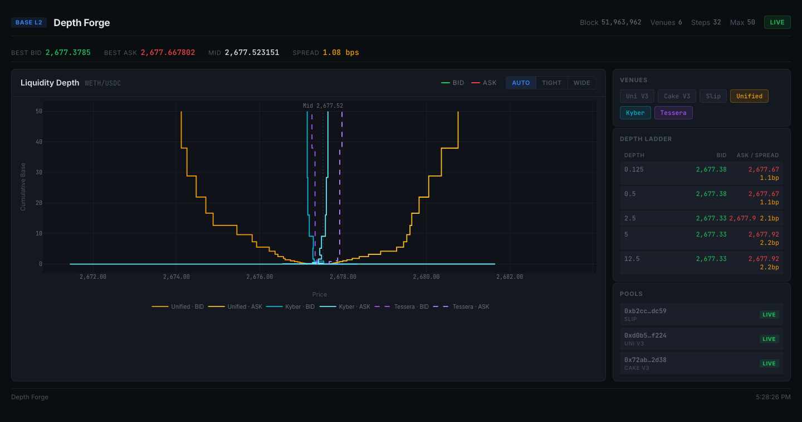

# base-depth-analysis

Snapshots and plots executable depth for WETH/USDC across Base liquidity venues: the three
largest concentrated-liquidity pools, the TesseraSwap prop AMM, and the KyberSwap aggregator
as a benchmark.



## The question

How much size can you trade on Base at a given price, and who is providing it? Headline pool TVL
does not answer this. Concentrated-liquidity pools can be deep inside a few ticks and empty
beyond them. A prop AMM prices off a curve its operator updates, with no pool state to inspect.
The only view that works for both is the same one: at a fixed block, what does each venue return
for a swap of size q, on each side?

This tool builds that curve per venue, plus a combined curve for the pools, so the venues can be
compared at the same block and the same sizes.

## How the curves are computed

Everything below comes from `crates/core/src/curve.rs` and the adapters in `crates/evm/src`.

**Size grid.** Sizes are set in base units (WETH) from `--min-base` to `--max-base` over
`--steps` points, spaced geometrically by default. The grid is dense near the top of the book and
sparse at the tail. On the ask side the grid is converted to USDC input using the mid price, so
both sides cover roughly the same notional.

**White-box pools (Uniswap v3, PancakeSwap v3, Aerodrome Slipstream).** State is read at the
pinned block: `slot0`, `liquidity`, `tickSpacing` and `fee` in one Multicall3 call. Tick bitmap
words and tick data are then loaded lazily as the swap crosses them. The swap is replayed off-chain
with the Uniswap v3 step math (`uniswap_v3_math::compute_swap_step`). The same code handles all
three forks; Slipstream pools are found by tick spacing instead of fee tier, and their dynamic fee
is read at the snapshot block. Each segment of the grid is applied to the simulated pool state in
turn, so point *i* is the marginal price of the *i*-th slice after the earlier slices have moved the
price.

**Black-box venues (TesseraSwap, KyberSwap).** No pool state to replay, so the venue is sampled
at each cumulative size `Q_i` and the curve is recovered by finite differences:

```
marginal_i = (quote_i - quote_{i-1}) / (base_i - base_{i-1})
```

Tessera is quoted with `eth_call` to its `tesseraSwapViewAmounts(tokenIn, tokenOut, amount)` view
at the pinned block. Kyber is quoted through its public aggregator API (`/routes`) with RFQ sources
excluded and gas excluded by default. Kyber can optionally refine the grid: it bisects any interval
where linear interpolation misses the mid-point quote by more than `--kyber-adaptive-bps`.

**Unified curve.** A greedy router over the white-box pools. For each slice of the grid it quotes
every pool at its current simulated state, fills the slice on the pool with the best output, and
advances that pool's state. For convex AMM curves this approaches the optimal split as the slices
shrink. It is a lower bound on what a real router gets, since each slice goes to one pool.

**Per-point output.** Each point records `cum_base`, the segment's base and quote amounts, the
marginal price (`seg_quote / seg_base`), and the average price to that depth
(`cum_quote / cum_base`). For v3 pools it also records the tick the segment ended at.

**UI stats.** The best bid/ask and depth ladder use the marginal price at each depth across the
selected venues. Kyber is left out of those stats: it routes through the same pools, and its
samples are not pinned to the snapshot block.

## Checks against on-chain quoters

At a pinned block (51,963,857), selling 100 WETH through the simulator and through the pools' own
QuoterV2 contracts (`--v3-quoter`) gave the same average price to within 1e-9 relative for Uniswap
v3 and PancakeSwap v3. For Slipstream, a 9.28 WETH sell matched Slipstream's QuoterV2 to within
0.00002 USDC (about 5e-10 relative). `cargo test` covers the step schedule, v2 constant-product math and the unified
curve builder.

## Running it

Requires a recent stable Rust toolchain.

```
cp .env.example .env    # optional; set BASE_RPC_URL to your own node
cargo build --release
```

Without `BASE_RPC_URL` or `--rpc-url` the tool uses `https://mainnet.base.org`, which rate-limits
this workload quickly. `https://base-rpc.publicnode.com` works for occasional snapshots; for the
live view, use your own node or a paid endpoint.

One snapshot to disk (writes `snapshot_meta.json` and `depth_points.csv`):

```
./target/release/base-depth-cli snapshot \
  --rpc-url https://base-rpc.publicnode.com \
  --max-base 100 --steps 32 \
  --out-dir snapshots/latest
```

Pin a block for reproducible results (applies to every venue except Kyber):

```
./target/release/base-depth-cli snapshot --block 51963857 --venues uniswap_v3,pancake_v3,slipstream,unified,tessera
```

Live view, rebuilt every `--interval` seconds and pushed to the browser over a WebSocket:

```
./target/release/base-depth-cli serve --interval 15 --max-base 50 --steps 32
# open http://127.0.0.1:8080
```

Useful flags:

| flag | effect |
|---|---|
| `--venues` | comma list of `uniswap_v3, pancake_v3, slipstream, pancake_v2, aerodrome_v2, unified, kyber, unified_kyber, tessera` |
| `--block N` | pin all on-chain reads to block N |
| `--side bid\|ask\|both` | restrict to one side |
| `--spacing linear\|geometric` | size grid spacing |
| `--v3-quoter` | quote Uniswap/Pancake v3 through QuoterV2 instead of the local simulator (for cross-checking) |
| `--kyber-steps`, `--kyber-concurrency`, `--kyber-adaptive-depth`, `--kyber-adaptive-bps` | Kyber sampling density and rate |
| `--kyber-client-id` / `KYBER_CLIENT_ID` | value sent as `x-client-id` (default `base-depth-analysis`) |
| `--tessera-sender` / `TESSERA_SENDER` | `msg.sender` for the Tessera view call |

## Output format

`depth_points.csv` has one row per curve point:

```
ts, block_number, pair, venue, pool, side, price, cum_base, seg_base, seg_quote,
marginal_price, avg_price, liquidity_tag
```

`snapshot_meta.json` records the chain id, block and timestamp, token metadata, the pools
included, and the grid and Kyber settings used.

## Layout

```
crates/core   curve construction, step schedule, unified router, CSV/JSON writer
crates/evm    Alloy RPC provider, v2/v3/Slipstream/Aerodrome simulators, pool discovery,
              QuoterV2, Tessera and Kyber quote engines
crates/cli    `snapshot` and `serve` commands; axum server for the UI
web           static UI (Plotly), no build step
```

## Limitations

- **One pair, three pools.** Pool discovery runs over every fee tier and tick spacing but is then
  filtered to a fixed allowlist in `crates/cli/src/main.rs`: Uniswap v3 0.05%
  (`0xd0b5…f224`), PancakeSwap v3 0.01% (`0x72ab…2d38`) and Slipstream tick spacing 100
  (`0xb2cc…dc59`). The Pancake v2 and Aerodrome v2 adapters exist but are excluded by that
  allowlist. Other pairs work via `--base`/`--quote`, but the allowlist has to be edited.
- **Quotes are not fills.** Every curve is a view-function or simulated quote at one block. It
  ignores gas, MEV and ordering within the block, and for the prop AMM, any gap between the
  quoted price and what a taker actually receives.
- **Tessera is a black box.** Its curve is sampled, not modelled, so its resolution is the grid
  resolution, and it is not part of the unified curve.
- **Kyber is not reproducible.** The aggregator API has no block parameter, so Kyber samples come
  from whatever state its backend has when each request lands. Close-together samples can give a
  noisy or non-monotone marginal curve. Treat it as a rough benchmark.
- **`unified_kyber`** currently samples Kyber with the same settings as `kyber`, so it duplicates
  it. It is kept as a separate venue but is off by default.
- **Float output.** Swap math runs in integers (Q64.96); prices and sizes are converted to `f64`
  only when points are written.
